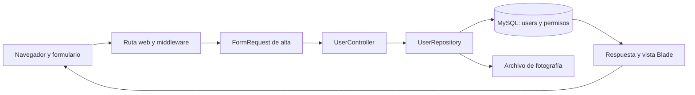

# Guía para entender el proyecto y preparar tu participación

## Qué pide el curso

El proyecto final vale 20 % y el enunciado fija entrega general el 9 de noviembre a las 8 p. m. No especifica una fecha independiente para la Fase 1 en el PDF revisado.

| Fase | Trabajo | Entrega |
|---|---|---|
| 1: diagnóstico | Identificar componentes, activos, riesgos y controles; mapear a NIST CSF 2.0. | Una Matriz General de Gobernanza que reúne a todos los módulos. |
| 2: evaluación | Demostrar los vectores solicitados mediante pruebas de concepto reproducibles de cada módulo. | Un documento grupal de PoCs. |
| 3: corrección | Implementar parches propios, volver a probar y valorar riesgo residual. | Matriz actualizada, reporte técnico de parches y video individual técnico de hasta cinco minutos. |

Tu trabajo de ahora está preparado en [gestion-de-usuarios.md](gestion-de-usuarios.md). Es material para incorporar al documento grupal, no una entrega independiente. El video de Fase 3 debe mostrar código e IDE; el enunciado excluye diapositivas y lectura de documentos en ese rubro.

## Qué es Unifiedtransform

Es una aplicación web de gestión escolar: administra docentes, estudiantes, clases, secciones, cursos, asistencias, exámenes, calificaciones, tareas y otros procesos. Tu copia también contiene auditoría de eventos.

El cliente es el navegador. El servidor ejecuta PHP/Laravel y genera páginas con plantillas Blade. Los datos se guardan en una base relacional; Docker Compose define servicios PHP, Nginx y MySQL. `composer.lock` fija Laravel 8.75.0. El README menciona Bootstrap 5, mientras que `package.json` declara Bootstrap 4.6: al documentar versiones se debe distinguir el README de los archivos de dependencias y de lo realmente servido.

Las rutas web usan sesiones, según `config/auth.php`. No hay motivo para describir este módulo como una API de microservicios con JWT: eso aparece como ejemplo de vector en el enunciado, no como arquitectura observada aquí.

## Cómo seguir una operación en el código

Para entender el alta de un docente, abrí estos archivos en orden:

1. `resources/views/teachers/add.blade.php`: formulario que envía nombres, correo, contraseña y datos de perfil.
2. `routes/web.php`: el POST `/school/teacher/create` llega a `UserController::storeTeacher`.
3. `app/Http/Requests/TeacherStoreRequest.php`: comprueba autorización `create users` y formato de entradas.
4. `app/Http/Controllers/UserController.php`: recibe los datos validados y delega.
5. `app/Repositories/UserRepository.php`: crea `User`, fija `role=teacher`, calcula hash de contraseña y asigna permisos dentro de una transacción.
6. `app/Models/User.php` y la migración de `users`: describen el modelo y su tabla.



Un **controlador** recibe una operación web; un **repositorio** agrupa el acceso a datos; un **modelo** representa entidades persistidas. El **middleware** comprueba condiciones comunes antes de ejecutar la operación. Un **FormRequest** combina autorización y validación para una solicitud concreta.

## La distinción central de tu módulo

Autenticación responde «¿quién está conectado?». Autorización responde «¿puede realizar esta acción sobre este usuario?». Validación responde «¿son aceptables los datos recibidos?».

En esta copia, `auth` identifica al usuario conectado y `view users` permite entrar a los métodos del controlador. Sin embargo, las funciones de edición no exigen explícitamente `edit users`, y el repositorio selecciona el destinatario por un ID enviado desde el cliente. Ese es un hallazgo prioritario de lectura de código: falta verificar con pruebas su efecto real y documentarlo en la fase correspondiente.

Ejemplo para explicarlo oralmente: «Poder consultar un perfil no debería autorizar modificar cualquier perfil. Por eso propongo verificar permiso de edición y autorización sobre el registro en el servidor». Ocultar el botón en la interfaz no establece por sí solo ese control.

Otro punto relevante: tener una tabla de auditoría no garantiza que todas las modificaciones queden registradas. La prueba existente usa `save()` sobre un modelo, pero las rutas de edición actualizan mediante el builder. Hay que verificar el recorrido que realmente utiliza el módulo.

## Qué significa tu matriz

Un **activo** es algo que protegés: perfil, credencial, fotografía o servicio. Un **riesgo** combina un escenario adverso con sus consecuencias. Un **control** es la medida concreta que reduce ese riesgo. La subcategoría **NIST** conecta tu propuesta con un resultado del marco.

Ejemplo del diagnóstico: activo `users` → posible modificación de perfiles ajenos → riesgo GU-R01 → control GU-C01 de autorización → mapeo PR.AA-05. La relación es una aplicación al sistema del [marco NIST CSF 2.0](https://doi.org/10.6028/NIST.CSWP.29); las puntuaciones y decisiones de implementación son propuestas del análisis.

Para exponer, podés decir:

> Mi módulo administra las identidades y los perfiles de docentes y estudiantes. Identifiqué como activos principales los datos personales, permisos, información familiar y registros de auditoría. La revisión del código muestra controles en las altas, pero brechas en autorización de edición y cobertura de auditoría. Mi línea base exige autorización por acción y registro, validación consistente y trazabilidad de las operaciones reales. La prueba de esos escenarios corresponde a la Fase 2.

## Cómo orientarte en el entorno

Desde la raíz del repositorio, estos comandos sirven para inspección si Docker y el servicio están disponibles:

```sh
docker compose ps
docker compose exec app php artisan --version
docker compose exec app php artisan route:list --path=teachers
docker compose exec app php artisan route:list --path=students
docker compose exec app php artisan route:list --path=school
```

No se ejecutaron esos comandos ni se inició el sistema durante esta preparación. El Compose publica HTTP en `localhost:8080`; eso no confirma que esté disponible ahora. Para navegar la parte estudiantil, el README indica configurar primero sesión escolar, semestre, clases y secciones.

Para pruebas futuras existe `php artisan test` y `phpunit.xml` propone SQLite en memoria. Antes de ejecutarlas, hay que comprobar aislamiento efectivo: esta copia contiene `bootstrap/cache/config.php`, y `RefreshDatabase` modifica el esquema de la conexión usada. No ejecutar `migrate:fresh --seed` sobre datos que se quieran conservar.

## Qué resolver con el equipo

- Confirmar aceptación de Unifiedtransform frente al requisito de aplicación intencionalmente vulnerable y viabilidad de los vectores posteriores.
- Acordar exactamente qué estudiantes puede consultar un docente y qué campos puede ver cada perfil.
- Coordinar contraseñas/correo con Autenticación, matrícula con Operaciones y eventos con Auditoría.
- Incorporar la sección preparada al documento único y completar nombre, carné, integrantes y acuerdos. No declarar pruebas exitosas o políticas aprobadas que aún no existan.
